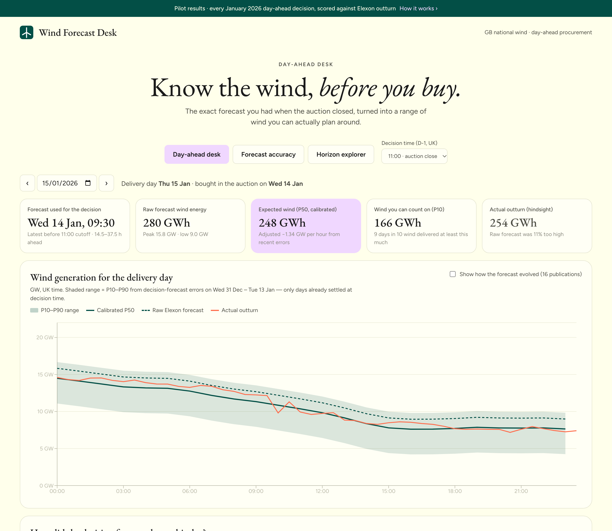
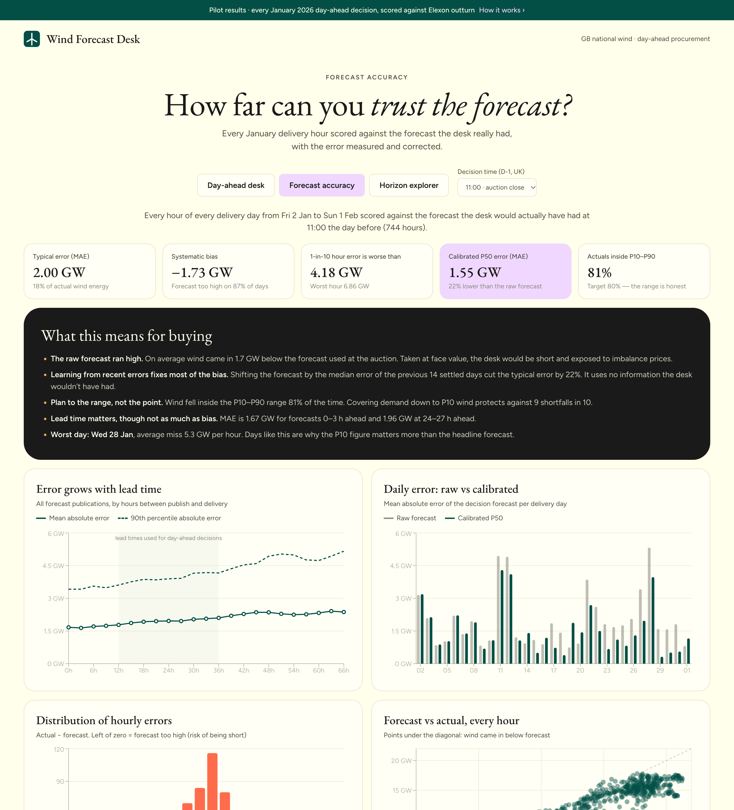
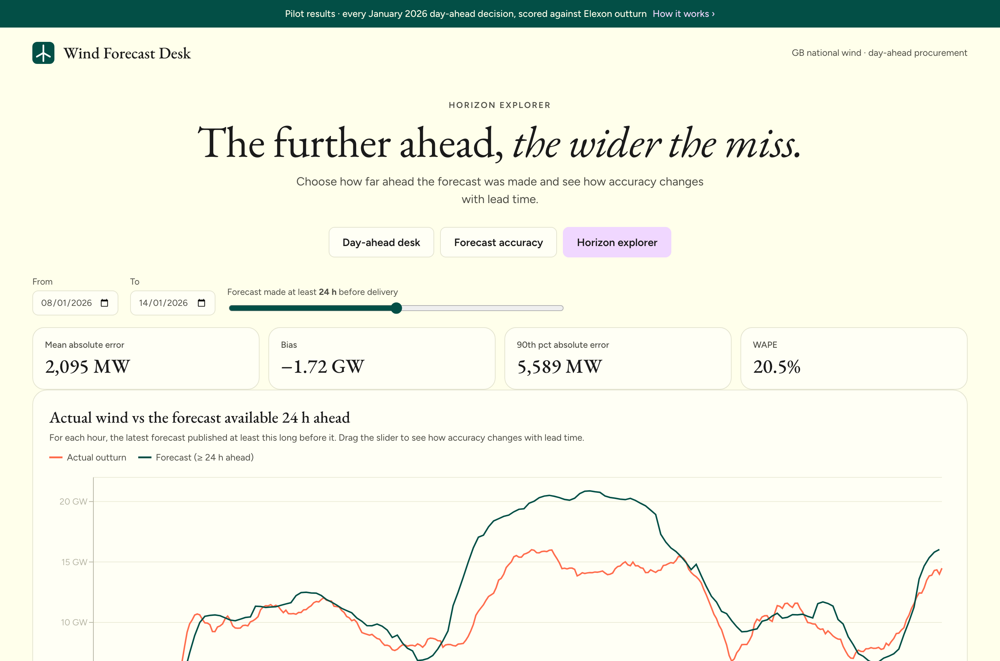

# Wind Forecast Desk

[](https://github.com/divyanshus2404/ws7qhz/actions/workflows/ci.yml)

A web app for a UK utility's day-ahead power buying desk. It answers two questions for every delivery day in January 2026:

1. **What did the latest wind forecast say when we had to decide?** That means the forecast available before the day-ahead auction closed at 11:00 UK time the day before, not one published later.
2. **How much can we trust it?** It measures the forecast error, turns it into an honest P10 / P50 / P90 range for wind, and shows how accuracy changes with lead time.

**Live app:** https://ws7qhz.vercel.app

Data is national GB wind only, from Elexon BMRS: [FUELHH](https://bmrs.elexon.co.uk/api-documentation/endpoint/datasets/FUELHH/stream) (actual outturn, `fuelType = WIND`, half-hourly) and [WINDFOR](https://bmrs.elexon.co.uk/api-documentation/endpoint/datasets/WINDFOR/stream) (forecast, hourly, published about 8 times a day).



<table>
  <tr>
    <td></td>
    <td></td>
  </tr>
  <tr>
    <td align="center"><b>Forecast accuracy</b></td>
    <td align="center"><b>Horizon explorer</b></td>
  </tr>
</table>

---

## What the app shows

| View | Purpose |
|---|---|
| **Day-ahead desk** | Pick a delivery day. You see the exact forecast publication used at the decision time, the wind energy it implies, a calibrated P50, a P10 figure ("wind you can count on 9 days in 10") and the P10–P90 range on a chart. Once the day has settled the actual outturn is overlaid. A toggle shows how the forecast for that day changed over its ~16 publications. |
| **Forecast accuracy** | Every hour of every January delivery day is scored against the forecast the desk really had. Shows MAE, bias, WAPE, P50/P90/P99 absolute error, and P10–P90 coverage. Charts show error against lead time, daily error (raw vs calibrated), the error distribution, forecast vs actual, and error by hour of day. A plain-English panel explains what this means for buying. |
| **Horizon explorer** | Choose a date range and a minimum lead time (0–48 h). For each hour the chart uses the latest forecast published at least that long before delivery. Drag the slider to watch accuracy get worse with lead time. |

Each tab can be linked directly: `#desk`, `#accuracy`, `#explorer`. The decision time can be changed (07:00 – 16:00 on D-1). Every view is recalculated so the desk can see what an earlier or later decision would have cost in accuracy.

## Key findings (January 2026, 11:00 D-1 decisions, 744 delivery hours)

| | Raw Elexon forecast | Calibrated P50 |
|---|---|---|
| Mean absolute error | **2.00 GW** (17.7% of wind energy) | **1.55 GW** (−22%) |
| Bias (actual − forecast) | **−1.73 GW** | −0.77 GW |
| 90th percentile absolute error | 4.18 GW | 3.59 GW |
| Actuals inside the P10–P90 range | – | **80.5%** (target 80%) |

- **The forecast ran high.** Outturn was below the forecast on 87% of days. At every lead time, even 0–3 h, the forecast was about 1.4–2 GW too high. That points to a systematic gap rather than weather uncertainty. The most likely cause is that FUELHH records metered output *after* constraint curtailment, while the forecast reflects available wind. This is a hypothesis to confirm with the client.
- **Calibrating with recent errors helps a lot.** The calibration only uses delivery days that had fully settled by decision time, so it is a genuine out-of-sample result.
- **Lead time matters less than bias:** MAE is 1.67 GW at 0–3 h ahead and 1.96 GW at 24–27 h ahead.

## How the core logic works

- **Decision forecast.** For delivery day *D*, the decision instant is the cutoff (default 11:00, Europe/London) on *D-1*. For each hourly target in *D*, the app takes the latest WINDFOR value with `publishTime ≤ cutoff`. In practice this is the 09:30 publication, 14.5–37.5 h ahead of delivery.
- **Error.** `error = actual − forecast` in MW. Negative means the forecast was too high, so the desk risks buying too little. Errors are only measured at timestamps where both datasets exist (the top of each hour). Values are never interpolated.
- **Calibration (P10 / P50 / P90).** For day *D*, take every decision-forecast error from the 14 delivery days *D-15 … D-2*. Those are the days that had fully settled by the decision. P*x* = forecast + *x*-th percentile of those errors, floored at 0. Nothing from day *D* or later leaks into it. This is unit-tested.
- **Fixed-horizon view.** For each target *T*, use the latest forecast with `publishTime ≤ T − horizon`.
- **Scope.** Decisions made in January 2026 cover delivery days **2 Jan – 1 Feb 2026**. Forecast and outturn history back to mid-December is loaded only so that the first January days have a full 14-day calibration window.

## Architecture

```
          Elexon BMRS (FUELHH, WINDFOR)
                     │  scripts/fetch_snapshot.py  (or DATA_SOURCE=live at startup)
                     ▼
   backend/data/*.csv ──► WindDataStore (in-memory, indexed by target time; bisect "as-of" lookups)
                                 │
                         analytics.py (pure functions: decision forecasts, calibration, metrics)
                                 │
                         main.py (FastAPI: validation, caching, JSON)  ── /api/*
                                 │
                 React + TypeScript + Recharts (Vite)  ── Day-ahead desk / Accuracy / Explorer
```

- **Backend:** Python 3.12, FastAPI. The analytics use only the standard library, with no pandas or numpy. The dataset is about 30k rows, so this keeps cold starts fast on serverless.
- **Store:** forecasts are indexed by target time, with each target's vintages sorted by publish time. "Latest forecast as of *t*" is then a single `bisect`.
- **Data source:** a committed CSV snapshot of the January data (about 1 MB), so the demo is fast and deterministic and doesn't depend on Elexon being up. `DATA_SOURCE=live` fetches the same window from Elexon at startup instead. Both paths go through the same `elexon.py` client.
- **Caching:** results are memoised per (delivery date, cutoff). The data is immutable, so there is nothing to invalidate.
- **Frontend:** React 18 + TypeScript (strict), Recharts. Typed API client, one `useApi` hook that discards stale responses, all times shown on the UK clock, and light/dark themes via CSS variables.

## Repository layout

```
.
├── api/index.py               Vercel serverless entry (wraps backend FastAPI app)
├── backend/
│   ├── app/
│   │   ├── config.py          Business scope & market conventions (dates, cutoff, quantiles)
│   │   ├── models.py          Dataclasses (ActualPoint, ForecastPoint, Pair) + time helpers
│   │   ├── elexon.py          Elexon BMRS client (chunked, retried)
│   │   ├── store.py           In-memory indexed store; CSV snapshot load/save; live loader
│   │   ├── analytics.py       Decision forecasts, calibration, metrics, accuracy report
│   │   └── main.py            FastAPI routes; serves built UI in Docker
│   ├── data/                  January 2026 snapshot (wind_forecasts.csv, wind_actuals.csv)
│   ├── scripts/fetch_snapshot.py   Refreshes the snapshot from Elexon
│   ├── tests/                 Unit tests (analytics, look-ahead safety) + API smoke tests
│   └── requirements*.txt
├── frontend/
│   ├── src/
│   │   ├── App.tsx            Shell, tabs, decision-time selector
│   │   ├── api.ts             Typed API client (mirrors backend response shapes)
│   │   ├── views/             DayAhead.tsx, Accuracy.tsx, Explorer.tsx
│   │   ├── components/ui.tsx  KPI tiles, cards, legends, tooltips
│   │   ├── format.ts, theme.ts, useApi.ts, styles.css
│   └── vite.config.ts         Dev proxy /api → :8000
├── Dockerfile                 Multi-stage: build UI → single FastAPI image serving UI + API
├── docs/screenshots/          README images
├── docker-compose.yml
├── vercel.json                Static UI + Python function for /api
├── requirements.txt           Python deps for the Vercel function
└── .github/workflows/ci.yml   pytest, frontend type-check/build, Docker build + smoke test
```

## Running it

**Docker (one command):**

```bash
docker compose up --build
```

Then open http://localhost:8000. Use `DATA_SOURCE=live docker compose up --build` to pull fresh data from Elexon at startup.

**Local development (hot reload):**

```bash
# API on :8000
cd backend
python3 -m venv .venv && source .venv/bin/activate
pip install -r requirements-dev.txt
uvicorn app.main:app --reload --port 8000

# UI on :5173 (proxies /api to :8000), in a second terminal
cd frontend
npm ci
npm run dev
```

**Tests:**

```bash
cd backend && pytest -q
cd frontend && npm run build   # strict TypeScript check + production build
```

**Refresh the data snapshot from Elexon:**

```bash
cd backend && python -m scripts.fetch_snapshot
```

**Deploy:** `vercel deploy --prod` from the repo root. `vercel.json` builds the UI and deploys `api/index.py` as a Python function. The Docker image also runs as-is on Heroku, Render or Cloud Run, because it honours `$PORT`.

## API

| Endpoint | Description |
|---|---|
| `GET /api/health` | Liveness |
| `GET /api/meta` | Scope, data ranges, number of publications |
| `GET /api/day-ahead?delivery_date=2026-01-15&cutoff=11:00` | Decision forecast, P10/P50/P90, actuals, energy summary, day metrics, all vintages |
| `GET /api/accuracy?cutoff=11:00` | Overall and calibrated metrics, band coverage, by hour, daily, histogram, scatter, by lead time |
| `GET /api/forecast?start=2026-01-08&end=2026-01-14&horizon_hours=24` | Fixed-horizon forecast vs actual over a date range |

Interactive docs are at `/docs` when running locally.

## Assumptions and limitations

- The day-ahead decision cutoff defaults to **11:00 UK on D-1** (GB EPEX/N2EX day-ahead auction close). The delivery day is the UK calendar day (00:00–24:00). The auction's formal delivery window is 23:00–23:00, but for this pilot the settlement day reads more naturally.
- WINDFOR is hourly and FUELHH is half-hourly. Accuracy is scored on the hourly timestamps only. Daily energy in the accuracy view is the sum of those hourly samples.
- National wind only, as per the brief. There is no demand data, so the app shows the wind side of "how much to buy" (the P10/P50 wind to net off demand) rather than a full procurement volume.
- The calibration is a simple, explainable shift by quantiles of recent errors. It does not yet depend on wind level or season.

## Next steps

- Net off the client's demand forecast to show the residual volume to buy at P10/P50.
- Make the calibration depend on wind level (errors grow with output) and on hour of day.
- Confirm the curtailment hypothesis using BOA/constraint data, and include embedded generation where relevant.
- Scheduled refresh from Elexon (cron + object store) for a live operational version.

## Use of AI tools

This project was built with the help of **Claude Code** (Anthropic), an AI coding assistant. It was used for domain research, generating backend and frontend code, tests, Docker/Vercel configuration and this README. The headline metrics were cross-checked against the raw Elexon responses.
